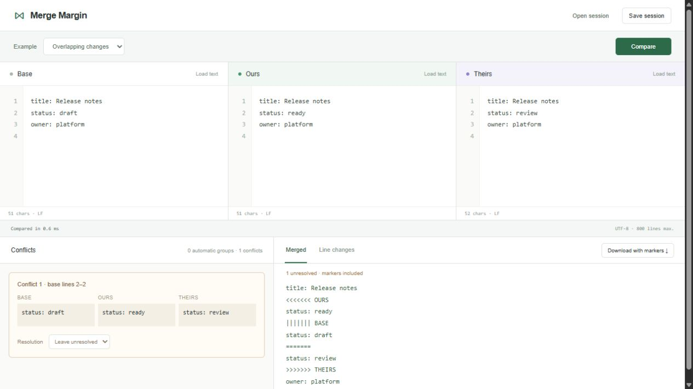

# Merge Margin

A dependency-free three-way text merge workbench. Compare a common ancestor with two branches, combine independent edits, and resolve overlapping changes with an auditable line diff.



## Interface

Three source editors share the upper workspace, with line-number gutters and separate colors for Ours and Theirs. Conflicts appear beside the merged document below. The output tabs switch between merged text and line changes; Left/Right keys move between tabs. Mobile source tabs show one document at a time. Editing a source clears stale resolutions and disables session export until the next comparison.

## Run

Requires Python 3.10+ to serve local assets. No installation or build step:

```sh
python run.py
```

Open http://127.0.0.1:8000. The server binds only to loopback. All document processing happens in a Web Worker in the browser; the server exposes only five static assets. Nothing is uploaded or persisted automatically.

## Use

- Paste or load UTF-8 base, ours, and theirs documents. Each is limited to 800 lines and 100,000 JavaScript string units. NUL and invalid UTF-8 files are rejected.
- Compare to combine independent and identical changes. Source edits invalidate earlier results and decisions.
- For each conflict, keep ours, theirs, or the base, or write a manual resolution. Empty manual text intentionally deletes that region.
- Download the resolved text. If decisions remain, the download is explicitly named `merged.conflicted.txt` and includes three-version conflict markers.
- Save a JSON session to preserve exact sources and resolution choices. Imported sessions are recomputed and validated before replacing the current documents. `docs/crlf-session.json` demonstrates CRLF and missing final newlines.
- Expand the line inspector to see insertions, deletions, both line numbers, and explicit newline styles.

## Implementation and tradeoffs

`core.js` tokenizes complete lines including their terminators. A dynamic-programming longest common subsequence constructs a minimum insertion/deletion script in O(nm) time and memory. Ties prefer deletion, making repeated-line behavior deterministic. Cross-branch overlapping hunks form connected components; each component is independently merged or presented as a conflict.

This is a deliberately conservative line merger, not Git's merge implementation. Adjacent replacements can merge, but insertions exactly at the boundary of another edit are treated as overlapping. It does not detect moves, parse syntax, ignore whitespace, or guarantee the fewest possible conflicts. Ambiguous repeated lines follow the deterministic LCS alignment.

Imported LF, CRLF, CR, mixed line endings, UTF-8 BOMs, and missing final newlines are preserved in raw source state. Keeping a version preserves its exact text. Editing a uniformly CRLF/CR document keeps that convention; editing mixed endings normalizes them to LF because browser textareas normalize line endings. Unresolved markers use the base's first newline convention (LF if absent) and add separators where necessary. Manual text is exact, so omitting its final newline can intentionally join the next line. Combined manual resolutions are limited to 100,000 string units.

`worker.js` isolates comparison from the UI. Source changes terminate stale work; import revision tokens prevent a late file read from overwriting a newer edit. File-size guards, bounded line counts, safe text-only DOM rendering, a static asset allowlist, Host validation, and a restrictive content policy bound the local tool's inputs and exposure.

## Verify

Node.js 22+ is required only for development checks:

```sh
npm test
npm run check
python -m unittest discover -s tests -p "test_*.py"
```

12 JavaScript tests cover exact endings, 300 seeded scripts against an independent minimum-edit oracle, reconstruction of both inputs, unchanged-side identity, adjacent and transitive overlap, competing insertions, deletions, resolution validation, and deterministic behavior. A Python integration test verifies static serving, HEAD, Host checks, and rejection of source/config paths. CI runs on Linux and Windows.

Browser validation covers independent merges, overlapping changes, branch selection, manual resolution, session save/reload, and byte-exact CRLF download without a final newline.

## References

Conceptual background: [GNU diff3 merging](https://www.gnu.org/software/diffutils/manual/html_node/diff3-Merging.html) and [git merge-file](https://git-scm.com/docs/git-merge-file.html). The implementation here is independent and intentionally has its own documented conflict policy.

The editor redesign was checked at desktop and 390-pixel widths, including automatic merges, conflict selection, manual resolution, keyboard output tabs, diff direction, source invalidation, and mobile source switching. All twelve merge-engine tests pass.
